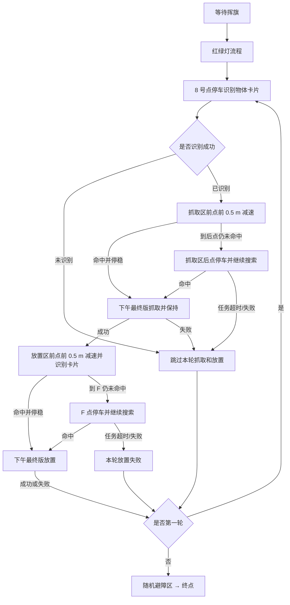

# 比赛场地完整流程 README

## 0. 比赛现场最简操作

与小车桌面旧 `readme.md` 一样，正式测试只需两个主操作：

1. 执行第 4 节的一条 launch 命令，一次性启动定位、全局轨迹、局部避障、安全链、状态机、相机、真实机械臂和底盘适配器；主 launch 不启动 RViz。
2. 按第 4.1 节单独启动 RViz，再执行第 5 节的 `/initialpose` 命令并确认扫描线与地图重合。需要查看红绿灯识别画面时，按第 4.2 节单独启动图像窗口。

初始位姿发布后状态机仍保持 `WAIT_START_FLAG` 和零速；实际比赛开始信号仍是挥旗。确认现场安全后挥旗，小车才会开始整条比赛流程。

## 1. 本版流程

本入口使用比赛场地地图、实地全局轨迹、导航专用 FAST-LIO 配置、AMCL 持续地图匹配、MPPI 跟踪、DWA 局部重规划、安全停车链和比赛任务状态机。

任务顺序是：

1. 等待挥旗。
2. 第一个红绿灯停车位沿行驶方向提前 `0.50 m`；正常速度接近，到实时刹车距离后一次性刹停，不执行最后 `0.5 m` 的任务点慢速爬行。
3. 第二个红绿灯点同样提前 `0.50 m` 并直接刹停；候选点1切到候选点2时局部轨迹热切换，不先停车等待重规划。
4. 两轮都在 8 号目标图点停车识别物体卡片，类别接受阈值为 `30%`，不再在识别点前 `1 m` 提前识别或限速。识别成功后才放行并启动本轮实物搜索；识别超时/失败则直接跳过本轮抓取和放置。
5. 识别成功离开 8 号点后先按全局速度行驶，到抓取区前点前 `0.5 m` 时按 `0.80 m/s²` 制动包络减速至最高 `0.10 m/s`，一直保持到抓取区后点。
6. 抓取段持续搜索实物；目标单帧置信度达到 `0.30`、且框中心位于画面右侧 `70%` 可接受区后，经控制器和安全层停车，停稳 `0.15 s` 后抓取。抓取不使用白色背景门控；RGB-D 定位从目标框外侧深度环带选择最近的稳定支撑平面，画面同时出现桌面和地面时优先桌面；桌面无法确认时不抓取。瓶子沿夹爪前向的总前探量为 `4.5 cm`，相对 `4.0 cm` 基线只额外靠近 `0.5 cm`。到抓取区后点仍未找到实物时停下继续搜索；抓取任务超时/失败后跳过本轮放置。
7. `pickup_rear` 已沿取货时车辆前进方向延后 `0.50 m`；抓取成功后恢复全局速度。到放置区前点前 `0.5 m` 开始减速，并在放置区后点前保持最高 `0.10 m/s`。`drop_rear` 也已沿卸货时车辆前进方向延后 `0.50 m`，两轮共用新的取放区后边界。匹配放置卡片后停车放置；到新的放置区后点仍未命中时停下继续搜索，放置任务超时/失败后进入下一轮。
8. 第一轮抓取或放置完成/失败后，从变道区外侧返回目标图片识别点并开始第二轮；抓取失败会跳过本轮放置区。
9. 第一次卸货后的返程按已冻结外圈基线返回图像识别点。第二轮抓取或放置完成/失败后进入最终随机避障段；20–21 点按操作员黑线向外放大，只对该入口使用 `1.30 m` 最小转弯半径，并在 22 点前保留约 `1.65 m` 的纵向对正段，避免斜向进入避障通道。返程弯和最终避障段均使用实验室比赛版通用局部避障参数：不再启用后来新增的返程全局参考优先模式和终段专用矩形足迹模式。`random_obstacle_exit` 只作路线参考，不要求精确经过；唯一硬目标是到达 `finish_park` 并停车。终点沿行驶方向超过原记录点 `0.20 m`，同样按实时车速计算触发点后一次性刹停，不执行最后 `0.5 m` 的低速爬行。



红绿灯识别在距第一候选停车点 `5.0 m` 时开启，只对相机左上区域（原图左侧 `50%` 与上方 `60%` 的交集）执行 HSV/轮廓识别；右侧 `50%` 和下方 `40%` 的颜色、深度候选都不参与判断。检测结果必须带有效深度且距离不超过 `10.0 m`，超过 `10.0 m`、没有深度或深度格式异常的纯颜色结果直接忽略。识别到绿灯、黄灯或灭灯等“非红灯”结果立即放行；红灯等待，但从停稳开始最多只等 `25 s`；始终没有识别结果也在 `25 s` 后放行。任何识别帧都不会重置这个绝对截止时间。

## 2. 事实与未验证项

已离线验证：状态机成功/失败分支、重复语义点按圈次触发、下午最终抓取/放置纯逻辑、视觉停车双层门控、红绿灯/终点直接刹停和候选点热切换、`1.0 m/s` 轨迹生成和车体足迹扫描。当前激活轨迹为 `1847` 点、`185.347 m`、`198.372 s`；按 `0.72 m × 0.50 m` 车体外加 `0.20 m` 余量扫描 `3694` 个姿态，碰撞数为 `0`。

本次实车日志已确认：第二次放置动作已启动，但在 `90 s` 超时前一直没有出现匹配卡片触发；第一次放置后返回识别点约用时 `79 s`，并在最终避障段继续运行约 `210 s` 而未完成。因此已停用这两个赛场后加的特殊规划模式，恢复实验室通用局部避障参数，并重新放大、提前返程全局弯；但“已解决卡顿”仍需下一次实车验证。`pickup_rear`、`drop_rear` 各沿行驶方向延后 `0.50 m` 后的新路线，以及最终避障入口 `1.30 m` 宽弯和 `1.65 m` 对正段，均尚未实车验证。其他未验证项包括：视觉触发到实际停车的位置误差、`30%` 图像卡片阈值的误检率、物体卡片未识别时两轮跳过分支、瓶子 `0.5 cm` 额外前探后的夹持深度、红绿灯/终点快速停车的实际停车误差、Open3D/检测模型并行预载的现场耗时、两轮放置失败时的持物状态处理和全流程时长。

## 3. 清理旧进程并配置 CAN

如果上一次终端还在运行，先在原终端按 `Ctrl+C`。紧急情况始终优先按小车物理急停。

```bash
cd /home/agilex/competition_ws
source scripts/car_source_env.sh

ros2 node list
ros2 topic info /cmd_vel

sudo ip link set can3 down 2>/dev/null || true
sudo ip link set can3 type can bitrate 500000 restart-ms 100
sudo ip link set can3 up
ip -details -statistics link show can3

sudo ip link set can2 down 2>/dev/null || true
sudo ip link set can2 type can bitrate 1000000
sudo ip link set can2 txqueuelen 1000
sudo ip link set can2 up
ip -details -statistics link show can2
```

此时不应存在不明的控制节点或 `/cmd_vel` 发布者。

## 4. 一条命令启动比赛状态机与整车

终端 1：

```bash
conda deactivate 2>/dev/null || true
cd /home/agilex/competition_ws
source scripts/car_source_env.sh

ros2 launch competition_bringup competition_field.launch.py \
  start_base:=true \
  start_chassis_adapter:=true \
  start_wrist_camera:=true \
  start_real_arm:=true \
  start_arm_simulator:=false \
  arm_post_instruction_clear_delay_s:=0.0 \
  rviz:=false \
  2>&1 | tee "/home/agilex/competition_ws/log/competition_field_$(date +%Y%m%d_%H%M%S).log"
```

这条命令会启动 Livox、导航专用 FAST-LIO、二维地图、AMCL 持续匹配、MPPI、局部 DWA、安全链、腕部相机、红绿灯/挥旗感知、真实机械臂和任务状态机，但不启动 RViz 或图像查看窗口。

`start_chassis_adapter:=true` 会在同一条 launch 中接通 `/cmd_vel_safe -> /cmd_vel`，因此不再需要额外启动底盘中继节点。状态机启动后默认是 `WAIT_START_FLAG`，挥旗前路线未使能，安全链应持续输出零速。

> 这是实车测试命令。执行前必须清空路线、准备物理急停，并确保旧的控制 launch 已经停止，否则会产生重复节点和重复底盘发布者。

### 4.1 单独启动 RViz

小车图形桌面另开终端：

```bash
conda deactivate 2>/dev/null || true
cd /home/agilex/competition_ws
source scripts/car_source_env.sh
export DISPLAY=:1
export XAUTHORITY=/run/user/1000/gdm/Xauthority
export XDG_RUNTIME_DIR=/run/user/1000

rviz2 -d /home/agilex/competition_ws/install/competition_bringup/share/competition_bringup/rviz/day5_motion_control.rviz
```

关闭这个 RViz 窗口不会停止状态机或底盘控制链。

### 4.2 单独查看红绿灯相机画面

小车图形桌面再开一个终端：

```bash
conda deactivate 2>/dev/null || true
cd /home/agilex/competition_ws
source scripts/car_source_env.sh

ros2 run rqt_image_view rqt_image_view
```

在窗口中选择 `/perception/wrist_traffic_annotated`。该画面用于核对红绿灯检测框和识别状态；如需查看原始彩色图像，可切换到 `/left_wrist_camera/camera/color/image_raw`。关闭图像窗口不会影响识别节点。

## 5. 在起点发布并校正初始位姿

把小车停在录点起点，车头方向与录点时一致。可以在 RViz 用 `2D Pose Estimate` 手动发布，也可以执行：

```bash
ros2 topic pub --once \
  --wait-matching-subscriptions 3 \
  --keep-alive 2.0 \
  /initialpose geometry_msgs/msg/PoseWithCovarianceStamped \
  "{header: {frame_id: map}, pose: {pose: {position: {x: 2.695737, y: 0.099940, z: 0.0}, orientation: {x: 0.0, y: 0.0, z: -0.008177, w: 0.999967}}, covariance: [0.01, 0.0, 0.0, 0.0, 0.0, 0.0, 0.0, 0.01, 0.0, 0.0, 0.0, 0.0, 0.0, 0.0, 0.0, 0.0, 0.0, 0.0, 0.0, 0.0, 0.0, 0.0, 0.0, 0.0, 0.0, 0.0, 0.0, 0.0, 0.0, 0.0, 0.0, 0.0, 0.0, 0.0, 0.0, 0.0076]}}"
```

在 RViz 中确认：

- 点云/扫描线与二维地图轮廓重合。
- 小车在全局轨迹起点，车头方向正确。
- 定位会随扫描持续修正，不是只使用一次初始位姿。

不重合时继续调整，禁止进入下一节。

## 6. 发车前门检

终端 2：

```bash
cd /home/agilex/competition_ws
source scripts/car_source_env.sh

/usr/bin/python3 scripts/day5_sensor_freshness_gate.py \
  --mode cloud \
  --timeout-s 20 \
  --max-p95-age-s 0.35 \
  --sample-count 20

ros2 topic echo /system_state --once
ros2 topic echo /control/state_valid --once
ros2 topic echo /avoidance/stop_request --once
ros2 topic echo /planning/local_replan_status --once
ros2 topic echo /mission/status --once
ros2 topic info /cmd_vel
ros2 topic echo /odom --once --field twist.twist.linear.x
```

必须同时满足：

- 点云门检是 `"status": "ready"`。
- 底盘 `control_mode: 1`、`error_code: 0`。
- `/control/state_valid` 是 `true`。
- `/avoidance/stop_request` 是 `false`，局部重规划无故障。
- `/mission/status` 是 `WAIT_START_FLAG`。
- `/cmd_vel` 只有一个 `ranger_twist_adapter` 发布者。
- `/odom` 车速为 `0.0` 或非常接近 `0.0`。

## 7. 确认定位后等待挥旗

> 从本节开始，挥旗被成功识别后小车会真实运动。必须先由现场人员确认初始位姿、清空路线并握住物理急停。

此时底盘适配器已由第 4 节的 launch 启动，不要再启动第二个 `ranger_twist_adapter_node`。状态机仍是 `WAIT_START_FLAG`，应只输出零速。确认初始位姿、局部重规划和安全状态都正常后，在腕部相机前按比赛方式挥动红旗。状态机进入 `RUN_TO_TRAFFIC_STOP` 后小车开始整个比赛流程。

调试时查看：

```bash
ros2 topic echo /mission/status
```

关键字段：`state`、`traffic_index` （1/2）、`cycle_index` （1/2）、`target_type`、`has_cargo`、`reason`。

## 8. 停止与故障处理

正常中止时在终端 1 按 `Ctrl+C`，同一条 launch 会同时停止状态机、安全链和底盘适配器。紧急情况先按物理急停，再按 `Ctrl+C`。

物体卡片无法识别不再进入 `MISSION_HOLD`，而是跳过本轮抓取和放置并继续后续流程。定位、避障、底盘、控制或其他安全链故障仍会进入 `MISSION_HOLD` 并断开路线。

视觉抓取失败采用继续比赛策略：本轮判定无货并跳过放置，第一轮直接进入第二轮目标识别，第二轮直接进入随机避障区和终点。视觉放置失败也采用继续比赛策略：第一轮进入第二轮，第二轮进入随机避障区和终点。这里的“继续”只适用于普通任务失败，不覆盖安全故障。放置失败后物理夹爪可能仍持物，这是当前未实车验证风险，不能把逻辑上的 `has_cargo=false` 当成夹爪已经张开的证据。

进入硬停后不要盲目重发放行命令。保留终端和 `/home/agilex/competition_ws/log` 的证据，停止整套系统，查明原因后重新从起点启动。

## 9. 配置文件索引

- 一体化入口：`src/competition_bringup/launch/competition_field.launch.py`
- 任务规则：`config/mission/competition_field_mission.yaml`
- 实地路线：`config/routes/competition_route.yaml`
- `1.0 m/s` 轨迹：`docs/evidence/day5/competition_field_mission_trajectory.yaml`
- 最终全局语义点/速度变化图：`docs/evidence/day5/competition_field_mission_semantic_speed_map_final.png`
- 停车识别与视觉抓取/放置事件配置：`config/mission/competition_field_mission.yaml`
- 红绿灯左上区域检测和有效深度/`10 m` 距离门限：`config/perception/wrist_traffic_rules.yaml`
- 下午视觉抓取/放置参数：`config/mission/competition_visual_manipulation.yaml`
- 下午交接原文：`docs/evidence/day5/README_HANDOFF_20260820_AFTERNOON.md`
- 激活轨迹足迹报告：`docs/evidence/day5/competition_field_mission_trajectory_footprint_check.md`
- 局部避障入口：`config/planning/planning_params_competition.yaml`
- 实际局部 Hybrid A* 运行参数：`config/planning/local_hybrid_astar_runtime_params_day5.yaml`
- 安全限制：`config/safety/safety_params_competition_segmented.yaml`
