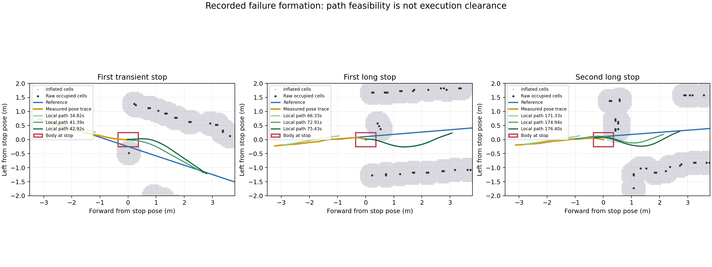
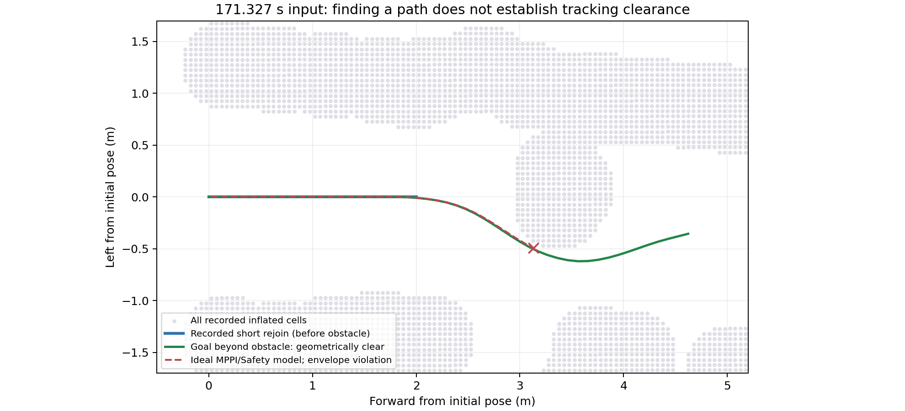
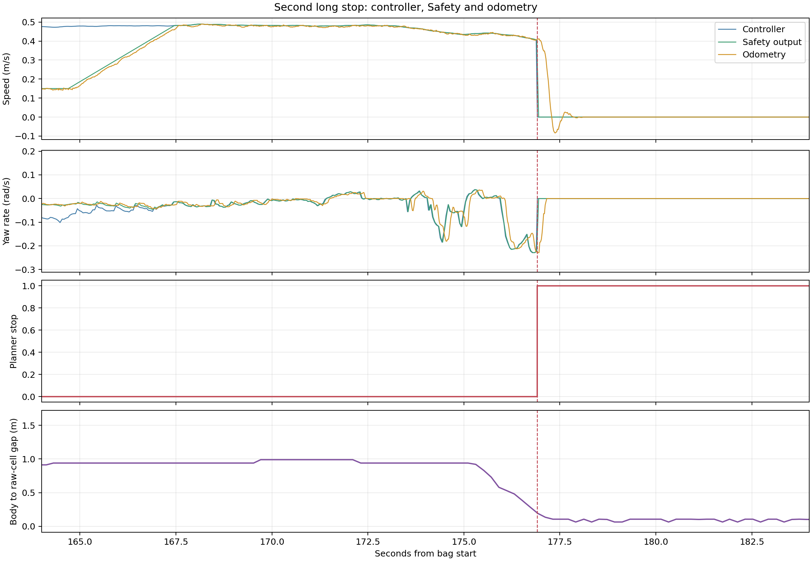

> 历史记录，仅用于追溯。当前版本、状态和操作统一见 [当前运行指令](../CURRENT_RUNBOOK.md)。文中“当前/明日/下一轮”均指记录当时。

# 2026-11-03：原 0.50 基线的停车形成过程

后续已按此诊断建立独立候选并完成离线回归，见[候选与次日操作单](23_FORWARD_REJOIN_CANDIDATE_2026-11-03.md)。下文保留诊断时的候选筛选状态，不代表最终独立候选的离线结果；实车仍未验收。

按“冻结基线→回放形成过程→单因素实验→通过后再实车”的顺序推进。本轮已完成归档、时序分析和候选筛选。**单改回接目标的候选没有通过持续跟随检查，因此没有部署运行修复，也没有进入实车阶段。** 新增的是离线诊断脚本、证据和报告，不是新一轮运行参数叠加。

## 主要结论

首要问题已从笼统的“膨胀太大/算法不实时”收敛为两个有复现证据的机制：

1. **回接目标不合适，短回接会让车辆继续靠近尚未绕过的障碍。** 完整搜索失败后，重构新增的 2 m/1.2 m 回接可以在障碍之前结束，并作为正常局部路径继续执行。相同输入将目标放到障碍后方，可以找到绕行；单纯加预算不能替代正确的目标选择。
2. **几何可行没有覆盖控制误差和失败后的停车过程。** 部分几何路径对向障碍侧仅 5 mm 的偏移就失效。当前 MPPI 在理想固定路径模型中也能因约 1 cm 跟踪误差越过既有硬包络。实际记录还显示零指令后约 0.8 s、约 0.10 m 的停车响应，足以消耗临障剩余空间。

这些证据支持优先修“规划目标和可执行余量的一致性”，不支持现在删除 Safety、缩小膨胀、套用官方 Critic 参数或简单全局加长超时。尚不能宣称已经找到唯一原因并修好避障。

## 1. 独立归档

归档：[原 0.50/0.30 分析基线](../../output/baselines/verified_050_030_20261102_reconstructed.zip)，77 个文件；[逐文件来源和哈希](../evidence/2026-11-03_frozen_050_baseline_manifest.json)。

源码使用前一份报告确认的 HEAD、车端修改前备份和已验证转弯修复 payload；参数取自实际运行快照。地图、路线、语义地图、优化配置的哈希与冻结轨迹 source_manifest 对应项一致。

这是**带来源说明的源码重建和分析归档，不是完整现场二进制镜像，也不是已经回退部署的运行目录**。原 launch 仍含车端绝对路径，不能直接把压缩包当作可发车安装包。V1/V2/V3 共享源码没有混入这个副本；当前工作树和车端安装未被回退。

原包：`/home/agilex/competition_rebuild_ws/log/retest_obstacle_full_loop_050straight_030turn_20261102_200354_970032218/rosbag/rosbag_0.db3`，72,032,256 字节，SHA256 见[诊断清单](../evidence/2026-11-03_origin_diagnostic_manifest.json)。

## 2. 回放方法及限制

读取 sqlite 的只读连接，不运行 rosbag play、不启动 ROS 节点、不发布话题。解析 1371 帧栅格、2752 帧扫描、368 条局部路径，以及 TF、控制/Safety/里程计和状态。

- 1369 帧栅格取得所需 TF，启动时两帧缺 TF，未计入空间统计。
- 保留记录到达顺序的最新 TF，同时用完整历史 TF 查询扫描时间。估计规划输入时先排除规划启动后才出现的地图，避免把未来地图错误地用于判定旧路径。
- 输入匹配保留时间残差：前面三个关键输入约 3 ms，后两个约 16 ms 和 99 ms。记录器的接收时刻不能完全代替节点内部回调时刻，因此仍属于近似重建。
- 没有原始 3D 点云和独立轮转角反馈；不能据此彻底排除外参、上游点云畸变或轮端执行问题。
- 原记录中操作员移动过障碍，停车后的通路变化与恢复不能一概视为算法自动解决。

## 3. 最早的异常发生在长停之前

第二次长停前的关键顺序如下，时间均相对录包开始：

| 时间 | 记录/复现 |
|---|---|
| 170.393 s | 参考路径仍作为普通行驶路径发布 |
| 171.327 s | 完整搜索失败后发布约 2 m 直线短回接；参考进度 566，回接 607，而首个被障碍挡住的参考点是 626 |
| 172.806 s | 现场记录进一步退到约 1.2 m 短回接；近似输入重建得到 2 m，二者都在障碍前结束，差异不隐藏 |
| 173.234–176.401 s | 才连续生成实际绕行几何，路径仍不断更新 |
| 176.911 s | 再次搜索无路，控制器随后进入 LOCAL_PLANNER_STOP |
| 177.718 s | 里程计速度才持续低于 0.02 m/s |
| 177.914 s 起 | 所查栅格中，起点虽未被占据，初始三种前进动作已全部被挡住 |

34.822 s 和 66.330 s 的更早绕行输入复现了相同模式：短回接分别结束在索引 86/240，首个障碍点却在 103/259。它不是已经完成绕行，只是找到了一段尚未碰到障碍的前进路。



上图灰层取相应停车时刻，绿线包含不同历史时刻，图例标明了路径时间。它用于展示形成过程，不能当作同一时刻的碰撞证明；同输入碰撞判断采用下面独立的密集检查。

## 4. 单因素搜索实验

选取 34.822、66.330、171.327、172.806、173.234 s 的五个停车前输入。前三个时间匹配残差约 3 ms。

| 实验 | 结果 |
|---|---|
| 原重构配置与源码重建 | 前四个输入退到障碍前短回接；第五个有完整绕行 |
| 只把预算从 0.4 s 增到 2.0 s | 前四个仍退到障碍前短回接，耗时约 2.03–2.04 s |
| 仅禁止更短回接 | 前四个变为超时，证明原有短回接是在掩盖完整搜索失败；直接禁用会增加停车，不能算解决 |
| 比赛原始代码及普通配置 | 五个输入均超时；室内路线没有启用比赛的语义放宽段 |
| 保持基线搜索参数，只试障碍后方目标 | 五个都能找到绕行，分别在约 4.0/4.0/4.5/3.5/3.5 m 回接；通过完整占用格复核 |

最后一组改变的是目标及其相应规划裁剪范围，静态地图、障碍输入、膨胀、采样与权重保持相同；不是一次性把全局前视改成某个建议值。4.0/4.5 m 是诊断试探位置，**不是已经推荐写入现场配置的固定前视参数**。

171.327 s 输入先试 4.0 m 超时，再试 4.5 m 成功，累计约 0.523 s；不能只摘取后一次约 0.12 s 的成功耗时，就声称满足 2 Hz。正式目标选择还必须有总预算约束。

源码对应问题：普通模式 `_select_navigable_rejoin_index` 侧重找可通行参考点，紧靠障碍边缘的回接目标不保证有航向回接空间；新增 `_plan_with_short_rejoin` 又可能退到障碍之前。比赛语义放宽模式已有稳定清空区段与持续绕行思路，但不能将其点名直接搬到另一张地图。

## 5. 为什么只修目标还不够

对五条障碍后方目标路径做了两层检查：

1. 原始几何和时间参数化后的几何，均用全量占用格、原附加膨胀、5 mm 间隔密集检查，五条均通过。
2. 固定路径交给原基线 MPPI/Safety，在静态障碍、理想指令执行、无感知/执行延迟、无路径切换的模型中持续行驶。五条中三条到达局部目标，两条越过既有膨胀包络。失败输入为 171.327、173.234 s，最大局部横向误差分别约 10.5、7.0 mm。

这不是物理碰撞证明，而是相对于配置碰撞包络的模型反例。成功三条也不等于实车验收通过。模型初速度统一取 0.48 m/s，随机种子为 7；没有轮胎、轮转向延迟和动态障碍。

再将路径沿各点法线轻微偏移做确定性检查：171.327、172.806、173.234 s 的路径向障碍侧偏移 5 mm，即出现禁区采样；66.330 s 路径向相应侧偏移 10 mm 也失效。说明“几何中心线不碰”与“容纳实际跟踪误差”不是同一条件。



图中蓝线是障碍前结束的原短回接，绿线是改到障碍后方的几何可行路径，红虚线是理想固定路径模型；叉号表示模型越过既有包络，并非实车撞击记录。

另做了受控实验：保持上述已选目标不变，只恢复比赛的软净距 0.20 m/权重 0.8。前四条路径逐点相同，只有第五条变化。因此不能把“恢复这两个值”当成已证实能提供跟踪余量的修复。偏好代价不能代替可执行余量检查。

这里需要容纳的是**相对于局部执行路径的实际跟随误差**，不能直接把初始位置相对全局参考线的固定偏移当作全部控制误差叠进去。

## 6. 感知、底盘与 Safety 的证据

- 栅格到达时的头部年龄中位约 45 ms、P95 约 63 ms、最大约 75 ms。记录可见的最新 TF 与按栅格时间查询的 TF 没有明显空间差异。当前证据不支持把大量长停首先归因于这个差时；不代替上游传感器时间和外参检查。
- 1211/1369 帧的裁剪占用格超过 2000，触发抽样，是保留的薄弱环节；仅凭这个比例还不能断言每次停车均由抽样导致。
- 175–176 s，控制/Safety 平均速度约 0.439 m/s，里程计约 0.435 m/s；176–177 s 对应约 0.380/0.421 m/s。Safety 与控制输出基本一致，没有独立近障停车触发。尚无独立轮端反馈来判定机械转向死区。
- 71.922 s 发出停车后，零速输出持续存在，约 0.855 s 后里程计稳定低于 0.02 m/s，期间积分前进约 0.100 m。
- 176.915 s 停车后，零速输出持续存在，约 0.803 s 后里程计稳定低于 0.02 m/s，期间积分前进约 0.108 m。TF 位移约 0.092 m，两种估计不完全相同。

第一段 40.916 s 的停车期间有重新给出的微小前进指令，不将其全部移动解释成零指令后的制动响应。以上时间包括软件、通信和机械响应，不能直接等同底盘纯制动延迟。



因此失败停车之前需要为搜索耗时和停车响应保留空间。车辆已经来到膨胀边缘，再宣布“无路并零速”，仍可能前进一段并进入前进模型难以恢复的位置。

## 7. 修复阶段的具体要求与当前状态

本轮没有把未经通过的候选继续部署。下一项实现应围绕**回接目标和安全前进的判定**，从本次冻结的原 0.50 副本出发：

1. 确认目标在阻塞段之后，并留出可完成航向回接的连续空间；不能把障碍前的短直线等同于绕行完成。
2. 对所选路径检查连续执行余量和失败后的停车空间，而非只检查离散路径点。边界应来自局部跟踪、时效和停车响应数据，不直接删减碰撞包络。
3. 目标试探共享同一规划预算；无合格目标时保持明确失败，不用连续短前进掩盖。
4. 逐项验证目标选择和执行余量，再验证动态重新规划。当前固定路径模型尚有反例，不能据此安排新一轮现场提速或直接发车。

这不是恢复 V1 的固定 4 m 前视，也不是直接移植 V3 平滑接入。软净距恢复本次未提供足够改善，未被采纳为运行修复。新的完整候选仍需完成有约束的目标选择、跟踪余量与动态规划验证。

## 8. 可复查产物

- [全部输入快照、逐时刻数据、模型轨迹、图和脚本](../../output/diagnostics/obstacle_origin_20261103.zip)。
- [搜索与模型结果摘要](../evidence/2026-11-03_origin_probe_summary.json)、[密集几何与横移检查](../evidence/2026-11-03_geometry_validation.json)、[停车响应](../evidence/2026-11-03_stop_response.json)。
- [原包/脚本/压缩包指纹](../evidence/2026-11-03_origin_diagnostic_manifest.json)。
- `scripts/analyze_obstacle_origin.py`：只读提取、TF/地图/路径时序检查及试验输入生成。
- `scripts/probe_obstacle_origin.py`：预算、短回接、比赛配置、目标和软净距的受控实验。
- `scripts/check_origin_path_following.py`：固定路径 MPPI/Safety 模型、密集几何与横移检查。
- `scripts/plot_obstacle_origin.py`：从 JSON 生成可分享的 PNG/SVG。

复现只需 ROS 消息库和冻结副本，不需要运行 ROS 图。实际调用形式：

```bash
source /opt/ros/humble/setup.bash
python3 scripts/analyze_obstacle_origin.py \
  --bag /path/to/recorded/rosbag_0.db3 \
  --baseline-root /path/to/extracted/verified_baseline \
  --output /tmp/obstacle_origin_analysis
```

所有输出均为离线分析资料。原比赛工程、运行安装目录、底盘和路线使能未被本轮改动。
