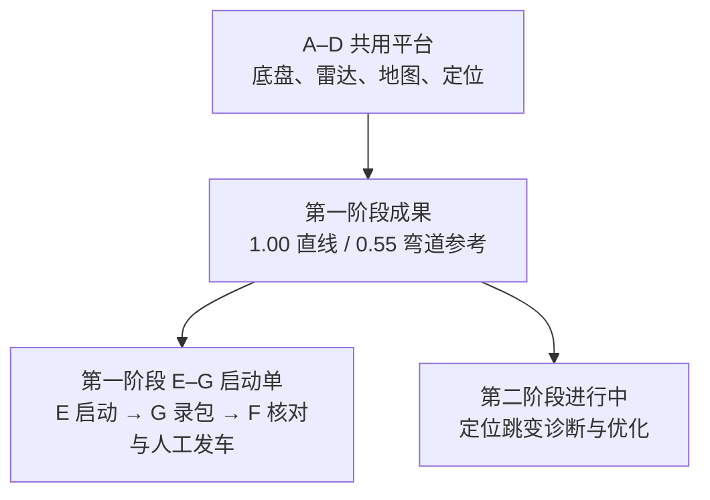

# 小车导航总览：先选阶段，再看启动单

更新：2026-11-20。日常操作只看本目录。第一阶段已经收束为昨天保留的弯道提速成果，第二阶段以定位跳变诊断与优化为主线。

## 最常用的三个入口

| 你要做什么 | 打开哪份文档 |
| --- | --- |
| 冷启动底盘、雷达、地图和定位 A–D | [README_A_D_PLATFORM.md](common/README_A_D_PLATFORM.md) |
| 使用第一阶段成果启动导航、核对和录包 E–G | [README_E_G_STAGE1.md](stage1/README_E_G_STAGE1.md) |
| 查看第二阶段要解决什么、从哪里继续 | [README_STAGE2_LOCALIZATION.md](stage2/README_STAGE2_LOCALIZATION.md) |

第一阶段的结果、参数和验证范围见 [README_STAGE1_RESULT.md](stage1/README_STAGE1_RESULT.md)。



## A–D 与 E–G 各管什么

| 组别 | 终端 | 职责 | 车端工作目录 |
| --- | --- | --- | --- |
| 共用平台 | A | 底盘反馈、Livox、FAST-LIO | `/home/agilex/competition_rebuild_ws`，并加载 `agilex_ws` 依赖 |
| 共用平台 | B | 静态地图与 RViz | `/home/agilex/competition_rebuild_ws` |
| 共用平台 | C | 给定位使用的激光扫描 | `/home/agilex/competition_rebuild_ws` |
| 共用平台 | D | AMCL 地图定位 | 第一阶段使用原 `amcl_rebuild_indoor.yaml` |
| 版本导航 | E | 本版本规划、控制与底盘适配 | 第一阶段为 `/home/agilex/competition_stepwise_100_turn055_smooth_20261119_ws` |
| 版本导航 | F | 版本核对、门检、人工发车与停车 | 与 E 使用同一版本目录 |
| 版本导航 | G | 本版本录包 | 与 E 使用同一版本目录 |

冷启动顺序为 **A → B → C → D → 实际位姿初始化 → E → G → F**。A–D 已健康运行且配置符合所选阶段时，沿用平台，只按版本启动 E–G。D 的定位配置也属于版本组合，复现第一阶段时应为原 `likelihood_field`。第二阶段若更改 D，会在对应候选中明确列出差异。

## 现在的阶段与版本

| 阶段 | 状态 | 版本与边界 |
| --- | --- | --- |
| 第一阶段：直线提速与弯道平顺化 | **成果已归档，作为后续基线** | `baseline-20261119-100-055-smooth-r035`，实测最低弯速约 0.29–0.30 m/s |
| 第二阶段：定位跳变优化 | **当前工作主线** | 从第一阶段继承。已有概率模型试验未通过，尚无已接受的第二阶段运行版 |

第一阶段成果的范围是空场整圈提速与衔接改善。最低弯速 0.50 m/s、障碍物净距和动态避障仍有待完成的验证，阶段划分不会将这些项目改写为已通过。

## 本地目录与车端目录怎么区分

```text
小车任务重构/                         本地项目
├─ README.md                          项目入口
├─ docs/navigation/                   日常只从这里找说明
│  ├─ common/README_A_D_PLATFORM.md    A–D 共用平台
│  ├─ stage1/README_STAGE1_RESULT.md   第一阶段成果
│  ├─ stage1/README_E_G_STAGE1.md      第一阶段 E–G 启动单
│  └─ stage2/README_STAGE2_LOCALIZATION.md
├─ baselines/                         固定归档、清单和恢复材料
├─ .codex-build/                      开发工作树、分析输出，日常无需进入
├─ candidates/、src/                  工程源码与历史候选
└─ output/                            打包及下载产物
```

`D:/CodexProjects/小车任务重构` 是电脑上的文件位置，`/home/agilex/...` 是 SSH 到小车后使用的位置。启动单中的命令均在车端对应终端执行。

## 需要追溯时再看

- [第一阶段冻结归档](../../baselines/baseline-20261119-100-055-smooth-r035/README_FROZEN_TURN055_20261119.md)
- [11 月 19 日故障核查与交接原记录](../../.codex-build/localization-20261119/docs/handoffs/README_NEXT_TEST_20261120.md)
- [提速升级经验](../../.codex-build/localization-20261119/docs/speed_upgrade/README_SPEED_UPGRADE_EXPERIENCE.md)
- [失败的 AMCL 概率模型试验](../../.codex-build/localization-20261119/candidates/localization_20261119/README_LOCALIZATION_BEAMSKIP_FAILED.md)
- [原冻结 025 操作单](../CURRENT_RUNBOOK.md)，用于历史版本恢复。
